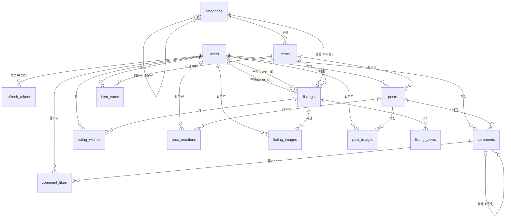

# RE:PICK DB 설계안 (MySQL 8)

> 근거: `docs/requirements.md`, `docs/spec-gaps.md`(1장 결정 + 3장 제안), `docs/api-spec-all.md`(컬럼 이름)
> 상태: **설계안(초안)**. SQL은 이 문서가 확정된 뒤 `db/schema.sql`에 작성한다.
> 표기: **제안** = 이 문서에서 새로 제안하는 것(팀 확인 필요)

## 목차

- [0. 범위와 공통 규칙](#0-범위와-공통-규칙)
- [1. ERD](#1-erd)
- [2. 테이블별 설계](#2-테이블별-설계)
- [3. 확인이 필요한 사항](#3-확인이-필요한-사항)

## 0. 범위와 공통 규칙

**만드는 테이블 (14개)**: `users`, `refresh_tokens`, `categories`, `items`, `listings`, `listing_images`, `listing_wishes`, `listing_views`, `posts`, `post_images`, `post_reactions`, `comments`, `comment_likes`, `item_votes`

**만들지 않는 것**

| 대상 | 이유 |
|---|---|
| 채팅, 알림, 리뷰, 마이페이지 | 요구사항에서 미구현 |
| 뱃지 | spec-gaps 1-#9 "뱃지 없음" |
| 판매글 댓글 | spec-gaps 1-#6 "댓글은 토론글에만" |
| `reports`, `blocks`, `settings` | API 없음·보류(1-#8, #13, #14). 필요할 때 spec-gaps 3장 설계대로 추가 |
| 시세 집계 테이블 | 시세·랭킹은 `listings`의 거래완료 행으로 계산. 느려지면 일별 집계 테이블을 추가 |

**공통 규칙**

| 항목 | 규칙 | 이유 |
|---|---|---|
| 문자셋 | `utf8mb4` / `utf8mb4_0900_ai_ci` | 이모지 저장, 대소문자 구분 없는 비교(닉네임 중복 검사가 자동으로 대소문자 무시) |
| PK | `id BIGINT AUTO_INCREMENT` | 현재 `schema.sql`이 `BIGINT`. FK는 양쪽 타입이 정확히 같아야 함 |
| 시간 | 모든 테이블에 `created_at`, `updated_at` (DATETIME, UTC) | API 응답은 UTC(`Z`)로 통일(api-spec 7장 #12) |
| 삭제 | 사용자가 만든 데이터 = 소프트 삭제(`deleted_at`), 관계 테이블(찜·리액션·좋아요) = 하드 삭제 | 글은 복구·분쟁 근거로 남기고, 관계 행은 지워도 잃는 정보가 없음 |
| Enum | `VARCHAR` + `CHECK`, 소문자 값 | ENUM보다 값 추가가 쉬움. MySQL 8.0.16부터 CHECK가 실제로 동작 |
| 예약어 | `condition`은 MySQL 예약어 | 쿼리에서 백틱(`` `condition` ``)으로 감싼다 |

> 아래 표에서 `created_at`, `updated_at`은 생략한다.
> FK 컬럼에는 MySQL이 인덱스를 자동으로 만든다. 표의 "인덱스"에는 **직접 만드는 것**만 적는다.

## 1. ERD

## 2. 테이블별 설계

### 2.1 `users` — 회원

| 컬럼 | 타입 | 제약 | 설명 |
|---|---|---|---|
| `id` | BIGINT | PK | |
| `login_id` | VARCHAR(30) | NOT NULL, UNIQUE | 소문자로 바꿔 저장 |
| `password_hash` | VARCHAR(255) | NOT NULL | bcrypt. 탈퇴하면 무작위 값으로 덮어씀 |
| `nickname` | VARCHAR(30) | NOT NULL, UNIQUE | 2~30자, 앞뒤 공백 제거 |
| `nickname_changed_at` | DATETIME | NULL | 닉네임은 30일에 1번만 변경 가능 |
| `email` | VARCHAR(255) | NULL, UNIQUE | 가입할 때는 필수(앱에서 검사). 탈퇴하면 NULL |
| `profile_image_url` | VARCHAR(500) | NULL | |
| `role` | VARCHAR(20) | NOT NULL DEFAULT `'user'`, CHECK (`user`, `admin`) | accessToken payload에 넣음(A3) |
| `deleted_at` | DATETIME | NULL | 소프트 삭제(탈퇴) |

| 인덱스 | 컬럼 | 이유 |
|---|---|---|
| `uk_users_login_id` | `login_id` | 로그인할 때 아이디로 찾음 + 중복 가입 방지 |
| `uk_users_nickname` | `nickname` | 닉네임 중복 방지. 탈퇴한 회원의 닉네임도 행이 남아 있어서 재사용이 막힘 |
| `uk_users_email` | `email` | 이메일 중복 방지. MySQL UNIQUE는 NULL을 여러 개 허용하므로, 탈퇴로 NULL이 된 행끼리는 충돌하지 않음 |

### 2.2 `refresh_tokens` — 발급한 Refresh 토큰

| 컬럼 | 타입 | 제약 | 설명 |
|---|---|---|---|
| `id` | BIGINT | PK | |
| `user_id` | BIGINT | NOT NULL, FK → `users` ON DELETE CASCADE | 기기마다 1행 |
| `token_hash` | CHAR(64) | NOT NULL, UNIQUE | SHA-256 해시. 원문은 저장하지 않음 |
| `expires_at` | DATETIME | NOT NULL | |
| `revoked_at` | DATETIME | NULL | 로그아웃·재발급으로 폐기된 시각 |

| 인덱스 | 컬럼 | 이유 |
|---|---|---|
| `uk_refresh_tokens_hash` | `token_hash` | `POST /auth/refresh`에서 해시로 바로 찾음 |
| `idx_refresh_tokens_expires` | `expires_at` | 하루 1번 정리 작업: 만료되거나 폐기된 지 7일 지난 행 삭제 |

> `user_id` 인덱스는 FK가 자동으로 만든다. 탈퇴할 때 `DELETE ... WHERE user_id = ?`(A6)에 쓰인다.

### 2.3 `categories` — 카테고리 (대분류-소분류)

| 컬럼 | 타입 | 제약 | 설명 |
|---|---|---|---|
| `id` | BIGINT | PK | |
| `parent_id` | BIGINT | NULL, FK → `categories` ON DELETE RESTRICT | NULL이면 대분류(카드/운동화/명품) |
| `code` | VARCHAR(30) | NOT NULL, UNIQUE | URL·필터용(`pokemon`). 영문 소문자·숫자·`-` |
| `name` | VARCHAR(50) | NOT NULL | 표시 이름 |
| `sort_order` | INT | NOT NULL DEFAULT 0 | 메뉴 표시 순서 |
| `is_active` | TINYINT(1) | NOT NULL DEFAULT 1 | 삭제하지 않고 숨김 |

| 인덱스 | 컬럼 | 이유 |
|---|---|---|
| `uk_categories_code` | `code` | `?category=pokemon`처럼 code로 찾음 + 중복 방지 |
| `idx_categories_parent_sort` | `parent_id, sort_order` | 카테고리 트리 조회(ITEM-01)를 정렬된 순서로 읽음. FK 자동 인덱스를 대신함 |

### 2.4 `items` — 공식 품목

| 컬럼 | 타입 | 제약 | 설명 |
|---|---|---|---|
| `id` | BIGINT | PK | |
| `category_id` | BIGINT | NOT NULL, FK → `categories` ON DELETE RESTRICT | 소분류 카테고리 |
| `slug` | VARCHAR(150) | NOT NULL, UNIQUE | URL용(`charizard-ex-sar-sv2a-201`) |
| `name` | VARCHAR(100) | NOT NULL | 품목명·모델명 |
| `set_name` | VARCHAR(100) | NULL | 카드만 |
| `card_no` | VARCHAR(30) | NULL | 카드만 |
| `language` | VARCHAR(5) | NULL, CHECK (`ko`, `ja`, `en`, `zh`) | 카드만 |
| `rarity` | VARCHAR(10) | NULL, CHECK (`SAR`, `UR`, `SR`, `AR`, `etc`) | 카드만 |
| `image_url` | VARCHAR(500) | NULL | |
| `is_active` | TINYINT(1) | NOT NULL DEFAULT 1 | 하드 삭제 금지. 숨김만 가능 |

| 인덱스 | 컬럼 | 이유 |
|---|---|---|
| `uk_items_slug` | `slug` | URL로 품목 조회 |
| `uk_items_card` | `category_id, set_name, card_no, language` | 같은 카드가 두 번 등록되는 것을 막음. 운동화·명품은 값이 NULL이라 이 제약에 걸리지 않음(UNIQUE는 NULL끼리 비교하지 않음). `category_id`가 맨 앞이라 FK 인덱스 역할도 함 |
| `ft_items_name` | FULLTEXT `name, set_name` WITH PARSER ngram | 통합 검색(HEADER-002), 품목 검색(ITEM-02). `LIKE '%리자몽%'`은 인덱스를 못 씀. ngram 파서는 한국어 부분 검색이 가능 |

### 2.5 `listings` — 판매글

| 컬럼 | 타입 | 제약 | 설명 |
|---|---|---|---|
| `id` | BIGINT | PK | |
| `registration_no` | VARCHAR(30) | NULL, UNIQUE | `RPC-2026-000123`. INSERT로 id를 받은 뒤 같은 트랜잭션에서 UPDATE하므로 NULL 허용 |
| `seller_id` | BIGINT | NOT NULL, FK → `users` | |
| `item_id` | BIGINT | NOT NULL, FK → `items` ON DELETE RESTRICT | 수정 불가(EDIT-002) |
| `category_id` | BIGINT | NOT NULL, FK → `categories` | **제안**: `items.category_id`의 복사본. 카테고리 필터를 JOIN 없이 인덱스로 처리. 품목은 수정할 수 없어서 값이 어긋나지 않음 |
| `title` | VARCHAR(100) | NOT NULL | |
| `description` | VARCHAR(1000) | NOT NULL DEFAULT `''` | ≤1000자(POST-014) |
| `price` | INT UNSIGNED | NOT NULL, CHECK 1 ~ 1,000,000,000 | |
| `condition` | VARCHAR(20) | NOT NULL, CHECK (`unopened`, `opened_raw`, `graded`) | |
| `grading_service` | VARCHAR(10) | NULL, CHECK (`PSA`, `BGS`, `CGC`, `BRG`) | |
| `grade` | VARCHAR(5) | NULL, CHECK (`10`, `9.5`, `9`, `8.5`, `8`, `7`) | |
| `delivery` | TINYINT(1) | NOT NULL DEFAULT 0 | 택배 가능 |
| `direct` | TINYINT(1) | NOT NULL DEFAULT 0 | 직거래 가능 |
| `direct_location` | VARCHAR(100) | NULL | 직거래 지역(동) |
| `attributes` | JSON | NULL | 운동화·명품 속성(`{"size":"270","styleCode":"..."}`) |
| `agreed_at` | DATETIME | NOT NULL | 책임 동의 시각(POST-016) |
| `status` | VARCHAR(20) | NOT NULL DEFAULT `'selling'`, CHECK (`selling`, `reserved`, `sold`) | |
| `view_count` | INT UNSIGNED | NOT NULL DEFAULT 0 | |
| `wish_count` | INT UNSIGNED | NOT NULL DEFAULT 0 | **제안**: 인기순 정렬용 집계. 찜 추가·해제와 같은 트랜잭션에서 ±1 |
| `sold_price` | INT UNSIGNED | NULL, CHECK 1 ~ 1,000,000,000 | 최종 거래가. 시세 계산에 사용 |
| `sold_at` | DATETIME | NULL | |
| `buyer_id` | BIGINT | NULL, FK → `users` ON DELETE SET NULL | |
| `deleted_at` | DATETIME | NULL | 소프트 삭제. 거래완료는 삭제 불가(앱에서 검사) |

**행 단위 CHECK**

| 이름 | 조건 | 이유 |
|---|---|---|
| `chk_listings_grade` | `condition = 'graded'`이면 `grading_service`, `grade`가 모두 있고, 아니면 둘 다 NULL | 잘못된 등급 조합이 시세 계산에 섞이지 않게 |
| `chk_listings_trade` | `delivery = 1 OR direct = 1` | 거래 방식을 최소 1개 선택(POST-015) |
| `chk_listings_sold` | `status = 'sold'`이면 `sold_price`, `sold_at`이 있음 | 시세 계산에 쓸 값이 빠진 거래완료를 막음 |

| 인덱스 | 컬럼 | 쓰는 곳 | 이유 |
|---|---|---|---|
| `uk_listings_registration_no` | `registration_no` | 상세 화면 | 등록번호 중복 방지 |
| `idx_listings_cat_status_created` | `category_id, status, created_at` | 목록 기본(LIST-002, 006, 007 최신순) | 카테고리 + "거래완료 제외" 조건으로 범위를 좁힌 뒤 최신순으로 바로 읽음 |
| `idx_listings_cat_status_price` | `category_id, status, price` | 낮은/높은 가격순, 가격 필터(LIST-005, 007) | 가격 범위 검색과 가격 정렬을 인덱스로 처리 |
| `idx_listings_item_status_price` | `item_id, status, price` | 같은 품목 다른 매물(DETAIL-010), ITEM-05, 토론방 "현재 매물" 탭 | 같은 품목의 판매중 매물을 가격 낮은 순으로 |
| `idx_listings_market` | `item_id, status, condition, grading_service, grade, sold_at` | 30일 시세(ITEM-04), 시세 대비 차이율 | `status='sold'` + 같은 상태·등급 + 최근 30일 범위를 인덱스 안에서 끝냄. 범위 조건(`sold_at`)은 맨 뒤에 둬야 앞 컬럼을 모두 쓸 수 있음 |
| `idx_listings_seller_status_created` | `seller_id, status, created_at` | 판매자의 다른 상품(DETAIL-009), `soldCount` | 판매자별 목록·거래완료 수. FK 자동 인덱스를 대신함 |
| `idx_listings_status_sold_at` | `status, sold_at` | 시세 랭킹(HEADER-009) | 최근 거래완료 전체를 기간으로 읽어 품목별로 집계 |
| `ft_listings_title` | FULLTEXT `title` WITH PARSER ngram | 통합 검색 | 품목명에 없는 단어(예: "PSA 10")가 제목에만 있을 때 |

> - `deleted_at`은 인덱스에 넣지 않는다. 삭제된 행은 소수라서 인덱스로 찾은 뒤 걸러도 비용이 작다.
> - **인기순**(찜 수 + 조회수)은 두 컬럼을 더한 값으로 정렬하므로 인덱스를 쓰지 못한다. 카테고리 인덱스로 범위를 좁힌 뒤 정렬하며, 데이터가 많아지면 `popularity` 컬럼을 추가한다.
> - 인덱스가 많으면 쓰기가 느려지지만, 판매글은 쓰기보다 읽기가 훨씬 많다.
> - 사이즈 필터(LIST-004, 미구현)를 만들 때는 `attributes->>'$.size'`를 가상 컬럼(generated column)으로 꺼내 인덱스를 건다. JSON 안의 값에는 인덱스를 직접 걸 수 없다.

### 2.6 `listing_images` — 판매글 사진·실물 인증 사진

| 컬럼 | 타입 | 제약 | 설명 |
|---|---|---|---|
| `id` | BIGINT | PK | |
| `listing_id` | BIGINT | NULL, FK → `listings` ON DELETE SET NULL | 업로드할 때는 NULL, 판매글 등록 때 연결 |
| `uploader_id` | BIGINT | NOT NULL, FK → `users` | 남의 이미지를 연결하지 못하게 검사 |
| `type` | VARCHAR(10) | NOT NULL, CHECK (`photo`, `auth`) | |
| `url` | VARCHAR(500) | NOT NULL | |
| `sort_order` | TINYINT UNSIGNED | NOT NULL DEFAULT 0, CHECK 0~9 | 0번이 대표 사진 |

CHECK: `type = 'photo' OR sort_order = 0` (인증 사진은 항상 0번)

| 인덱스 | 컬럼 | 이유 |
|---|---|---|
| `uk_listing_images_order` | `listing_id, type, sort_order` | ① 판매글 안에서 순서 중복 방지 ② 인증 사진은 `sort_order`가 항상 0이라 **판매글당 1장이 DB에서 보장됨** ③ 상세 화면의 사진 목록과 대표 사진(`sort_order = 0`) 조회. NULL인 행끼리는 충돌하지 않아 연결 전 이미지가 여러 개여도 됨 |
| `idx_listing_images_orphan` | `listing_id, created_at` | 하루 1번 정리 작업: `listing_id IS NULL`이고 24시간 지난 이미지를 파일과 함께 삭제 |

### 2.7 `listing_wishes` — 찜

| 컬럼 | 타입 | 제약 | 설명 |
|---|---|---|---|
| `user_id` | BIGINT | PK(1), FK → `users` ON DELETE CASCADE | |
| `listing_id` | BIGINT | PK(2), FK → `listings` ON DELETE CASCADE | |

| 인덱스 | 컬럼 | 이유 |
|---|---|---|
| PK | `user_id, listing_id` | 1인 1찜 보장. `isWished`와 "내 찜 목록"(`user_id`로 시작)을 이 인덱스로 처리 |

> - 다른 테이블이 찜을 참조하지 않으므로 별도 `id`가 필요 없다.
> - `listing_id` 인덱스는 FK가 자동으로 만든다(판매글별 찜 조회, CASCADE 삭제).
> - 판매글이 소프트 삭제돼도 찜 행은 남긴다. 조회할 때 `listings.deleted_at IS NULL`로 뺀다.

### 2.8 `listing_views` — 조회수 중복 방지 (**제안**)

| 컬럼 | 타입 | 제약 | 설명 |
|---|---|---|---|
| `listing_id` | BIGINT | PK(1), FK → `listings` ON DELETE CASCADE | |
| `viewer_key` | VARCHAR(70) | PK(2) | 회원 `u:{userId}`, 비회원 `ip:{IP의 SHA-256}`. IP 원문은 개인정보라 저장하지 않음 |
| `viewed_on` | DATE | PK(3) | 조회한 날짜(KST) |

| 인덱스 | 컬럼 | 이유 |
|---|---|---|
| PK | `listing_id, viewer_key, viewed_on` | `INSERT IGNORE`가 성공했을 때만 `view_count + 1` → 같은 사람이 같은 날 다시 봐도 안 셈 |
| `idx_listing_views_date` | `viewed_on` | 이틀 지난 행 정리 |

### 2.9 `posts` — 토론글

| 컬럼 | 타입 | 제약 | 설명 |
|---|---|---|---|
| `id` | BIGINT | PK | |
| `user_id` | BIGINT | NOT NULL, FK → `users` | |
| `board` | VARCHAR(20) | NOT NULL, CHECK (`pokemon`, `sneakers`, `onepiece`, `watch`, `free`) | |
| `tag` | VARCHAR(20) | NULL, CHECK (`analysis`, `verify`, `unboxing`, `poll`, `qna`, `info`) | |
| `item_id` | BIGINT | NULL, FK → `items` ON DELETE RESTRICT | 지금은 VARCHAR → BIGINT FK로 바꿈. 자유게시판 글은 NULL |
| `title` | VARCHAR(100) | NULL | 1-#1 |
| `body` | VARCHAR(500) | NOT NULL | 지금은 TEXT → 500자 제한(BWRITE-003) |
| `reaction_count` | INT UNSIGNED | NOT NULL DEFAULT 0 | 인기순 정렬용 |
| `comment_count` | INT UNSIGNED | NOT NULL DEFAULT 0 | 인기순 정렬용 |
| `edited_at` | DATETIME | NULL | **제안**: "(수정됨)" 표시용(BEDIT-004). `updated_at`은 리액션·댓글 수가 바뀔 때도 갱신되므로 쓸 수 없음 |
| `deleted_at` | DATETIME | NULL | 소프트 삭제 |

| 인덱스 | 컬럼 | 이유 |
|---|---|---|
| `idx_posts_board_created` | `board, created_at` | 커뮤니티 피드 게시판별 최신순(기존과 같음) |
| `idx_posts_item_created` | `item_id, created_at` | 품목 토론방 최신순(BOARD-006). FK 자동 인덱스를 대신함 |
| `idx_posts_created_item` | `created_at, item_id` | "실시간 많이 언급된 품목" TOP5(BOARD-010): 최근 24시간 글을 품목별로 셈. 두 컬럼 모두 인덱스에 있어 테이블을 읽지 않음 |

> 토론방 인기순(리액션 + 댓글 수)도 두 값을 더해 정렬하므로 인덱스를 쓰지 못한다. `item_id`로 범위를 좁힌 뒤 정렬한다.

### 2.10 `post_images` — 토론글 사진

| 컬럼 | 타입 | 제약 | 설명 |
|---|---|---|---|
| `id` | BIGINT | PK | |
| `post_id` | BIGINT | NULL, FK → `posts` ON DELETE SET NULL | 업로드할 때는 NULL |
| `uploader_id` | BIGINT | NOT NULL, FK → `users` | |
| `url` | VARCHAR(500) | NOT NULL | |
| `sort_order` | TINYINT UNSIGNED | NOT NULL, CHECK 0~3 | 최대 4장(BWRITE-002) |

| 인덱스 | 컬럼 | 이유 |
|---|---|---|
| `uk_post_images_order` | `post_id, sort_order` | 순서 중복 방지 + 글의 사진 목록 조회. `sort_order`가 0~3이라 **글당 4장이 DB에서도 보장됨** |
| `idx_post_images_orphan` | `post_id, created_at` | 연결 안 된 이미지 24시간 정리 |

### 2.11 `post_reactions` — 이모지 리액션

| 컬럼 | 타입 | 제약 | 설명 |
|---|---|---|---|
| `user_id` | BIGINT | PK(1), FK → `users` ON DELETE CASCADE | |
| `post_id` | BIGINT | PK(2), FK → `posts` ON DELETE CASCADE | |
| `type` | VARCHAR(20) | NOT NULL, CHECK (`fire`, `surprised`, `laugh`, `ice`) | 🔥😮😂🧊 |

| 인덱스 | 컬럼 | 이유 |
|---|---|---|
| PK | `user_id, post_id` | 글 하나당 1인 1개(BOARD-008). 다른 이모지를 누르면 `type`만 UPDATE |
| `idx_post_reactions_post_type` | `post_id, type` | 글 상세의 이모지별 개수(`GROUP BY type`). FK 자동 인덱스를 대신함 |

> 취소하면 하드 삭제한다. INSERT/DELETE와 `posts.reaction_count ± 1`은 한 트랜잭션에서 처리한다.

### 2.12 `comments` — 댓글·답글

| 컬럼 | 타입 | 제약 | 설명 |
|---|---|---|---|
| `id` | BIGINT | PK | |
| `post_id` | BIGINT | NOT NULL, FK → `posts` ON DELETE CASCADE | 토론글에만 달림(1-#6) |
| `user_id` | BIGINT | NOT NULL, FK → `users` | |
| `parent_id` | BIGINT | NULL, FK → `comments` ON DELETE CASCADE | NULL = 댓글, 값 있음 = 답글. 답글의 답글 금지는 앱에서 검사(CHECK는 다른 행을 볼 수 없음) |
| `body` | VARCHAR(500) | NOT NULL | 1-#5에서 500자로 결정 |
| `like_count` | INT UNSIGNED | NOT NULL DEFAULT 0 | |
| `deleted_at` | DATETIME | NULL | 답글이 있으면 "삭제된 댓글입니다"로 남김 |

| 인덱스 | 컬럼 | 이유 |
|---|---|---|
| `idx_comments_post_parent_id` | `post_id, parent_id, id` | 글의 댓글(`parent_id IS NULL`)을 오래된 순으로 커서 페이징. `id`가 작성 순서와 같아 `created_at` 대신 사용. FK 자동 인덱스를 대신함 |
| `idx_comments_parent_id` | `parent_id, id` | 답글 더보기(오래된 순). FK 자동 인덱스를 대신함 |
| `idx_comments_created` | `created_at` | TOP5 품목 집계에서 최근 24시간 댓글을 찾음(글과 JOIN해서 `item_id`를 얻음) |

### 2.13 `comment_likes` — 댓글 좋아요

| 컬럼 | 타입 | 제약 | 설명 |
|---|---|---|---|
| `user_id` | BIGINT | PK(1), FK → `users` ON DELETE CASCADE | |
| `comment_id` | BIGINT | PK(2), FK → `comments` ON DELETE CASCADE | |

| 인덱스 | 컬럼 | 이유 |
|---|---|---|
| PK | `user_id, comment_id` | 1인 1좋아요 + 내가 눌렀는지 조회 |

> `comment_id` 인덱스는 FK가 자동으로 만든다. 취소 = 하드 삭제, `comments.like_count ± 1`을 같은 트랜잭션에서.

### 2.14 `item_votes` — 시세 전망 투표

| 컬럼 | 타입 | 제약 | 설명 |
|---|---|---|---|
| `user_id` | BIGINT | PK(1), FK → `users` ON DELETE CASCADE | |
| `item_id` | BIGINT | PK(2), FK → `items` ON DELETE CASCADE | |
| `vote_date` | DATE | PK(3) | 서버가 계산한 **KST** 날짜 |
| `direction` | VARCHAR(10) | NOT NULL, CHECK (`up`, `down`) | 🔥 오른다 / 🧊 내린다 |

| 인덱스 | 컬럼 | 이유 |
|---|---|---|
| PK | `user_id, item_id, vote_date` | 품목당 하루 1회(BOARD-004). 두 번째 INSERT는 중복 키 에러 → 409 |
| `idx_item_votes_item_date` | `item_id, vote_date, direction` | 투표 비율 집계(BOARD-003)를 인덱스만 읽고 끝냄 |

## 3. 확인이 필요한 사항(확인완료)

| # | 항목 | 내용 | 이 문서의 가정 |
|---|---|---|---|
| 1 | 댓글 길이 | 500자 | 
| 2 | `listings.category_id` 복사 | 추가(카테고리 필터 성능) | 추가(카테고리 필터 성능) | 
| 3 | `listings.wish_count` |  추가(인기순 정렬에 필요) | 추가(인기순 정렬에 필요) |
| 4 | 투표 비율 기간 | 인덱스는 세 경우 모두 지원 | 인덱스는 세 경우 모두 지원 |
| 5 | 조회수 기준 |  날짜 기준(구현이 단순함) | 날짜 기준(구현이 단순함) |
| 6 | 찜 테이블 이름 |  `wishes` | `wishes` |
| 7 | 검색 방식 | ngram 사용. 처음에는 LIKE로 시작 | ngram 사용. 처음에는 LIKE로 시작해도 됨 |
| 8 | 공식 품목 없는 판매글 | `item_id` 필수 | `item_id` 필수 |
